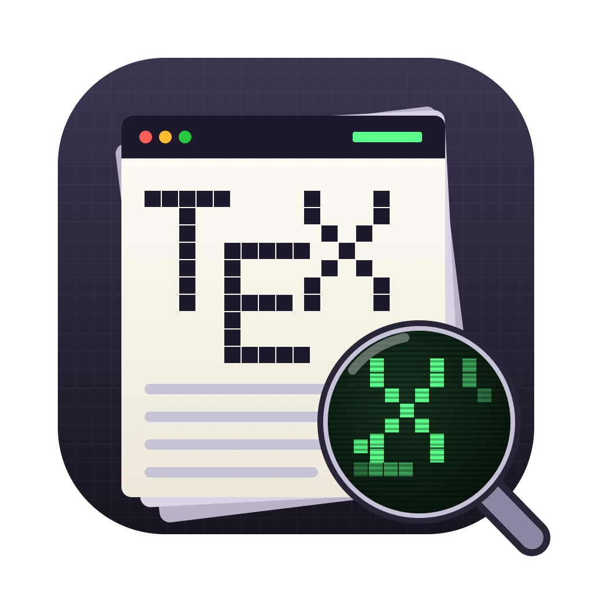

<p align="center"></p>

# TeX Split

For people who write a thesis in a Git repository with a coding agent in the
terminal (Claude Code, Codex and the like), and who still want to write it
themselves.

In an agentic writing loop you start by commenting. You read the rendered PDF,
mark what is wrong, and the agent revises; over many rounds it learns how you
write. But at some point a comment is the long way round: you know the word
you want, and you just want to change it. For that you need the PDF and the
LaTeX open together.

TeX Split keeps that reflective friction in the loop. The LaTeX source is on
the left, where you change a word or rewrite a sentence yourself, and the
compiled PDF is on the right, where you read and mark it up the way you would
in Preview.

### The loop

1. The agent works in the repository: branches, commits, checks.
2. You read a chapter as a PDF and mark it up: highlights, notes, shapes.
3. What you want to change yourself, you change in the source beside it.
   The PDF follows as you type, a few seconds behind.
4. ⇧⌘E sends the remaining marks to `render/review/live/`, each with its file
   and line, and the agent works through them.
5. When the agent saves a file you have open, the window reloads. If you have
   unsaved edits it asks first, so your own writing is never overwritten.

## What it does

- **One window per `.tex` file.** Open as many chapters as you like and
  place them side by side. ⌘1, ⌘2 and ⌘3 show the LaTeX only, both, or the
  PDF only.
- **Live preview.** About a second after you stop typing, the chapter is
  rebuilt from the text on screen and the PDF updates, roughly 5 seconds
  from keystroke to page. Your file on disk only changes when you save, so
  an agent never sees half-typed text. View › Live Preview (⇧⌘L) turns it
  off; while the LaTeX does not compile, the last good PDF stays.
- **Fast chapter builds.** Saving (⌘S) rebuilds only that chapter, with
  [Tectonic](https://tectonic-typesetting.github.io/) and SyncTeX, in
  seconds instead of a minute for the whole document.
- **Numbered as the whole document.** One build of the whole document runs
  in the background. Each chapter build takes its chapter number, page
  numbers and every cross-reference from it, so chapter 5 stays chapter 5
  and `\ref` into other chapters does not print `??`.
- **Preview's markup tools.** The PDF view runs on PDFKit, the engine
  Preview uses, with Preview's toolbar, menus and shortcuts:
  highlight in five colours, underline and strike-through (⌃⌘H, ⌃⌘U, ⌃⌘S),
  notes (⌃⌘N), rectangles, ovals, lines and arrows (⌃⌘R, ⌃⌘O, ⌃⌘L, ⌃⌘A),
  text boxes (⌃⌘T), sketch and draw, signatures, rectangular selection,
  colours and line widths. Marks can be selected, moved, resized, copied,
  duplicated (Option-drag) and deleted, with undo.
- **Preview's sidebar and navigation.** Thumbnails, table of contents,
  highlights and notes, bookmarks (⌘D), contact sheet, search (⌥⌘F),
  zoom, rotation, single, continuous or two-page display, print and export.
- **Source and PDF linked.** ⌘-click in the PDF jumps to the LaTeX line;
  ⌘J shows the line at the cursor in the PDF.
- **Marks survive rebuilds.** Every mark is anchored to the source line
  under it. After a rebuild, highlights are found again by their text near
  that line, and other marks move with the line.
- **A review queue for later.** "Send Marks to Review Queue" (⇧⌘E) writes
  every mark with its source file and line, as JSON and Markdown, plus a
  marked copy of the PDF, so a person or a script can work through them.
- **Safe beside other editors.** If another program saves a file you have
  open, an unedited window reloads; a window with unsaved edits asks first.

## Requirements

- macOS 14 or later
- Swift 5.10 or later (Xcode or the Command Line Tools: `xcode-select --install`)
- Tectonic: `brew install tectonic`

## Install

```sh
git clone https://github.com/jakoraner/texsplit.git
cd texsplit
./make-app.sh
```

This builds the app and installs it as `~/Applications/TeX Split.app`.
Open a `.tex` file with it, or start it and choose File › Open.

## How it expects a project to look

TeX Split was written for one thesis and makes a few assumptions:

- The project has a `main.tex` in the file's folder or a folder above it.
- `main.tex` pulls chapters in with `\input{Chapters/…}`,
  `\input{Backmatter/…}` or `\input{Frontmatter/…}`. Only those files can be
  built on their own; any other file builds the whole document.
- Builds run on a copy in `~/Library/Caches/TeXSplit/`, never in your
  project. In that copy `backend=biber` is switched to `backend=bibtex`,
  because Tectonic's biblatex and Homebrew's biber disagree on versions.
- Marks and review queues are written to `render/review/live/` in the
  enclosing git repository (its main checkout if you work in a worktree).

If your project is laid out differently, these are the places to change:
`Builder.swift` (what gets built and how) and `Marks.swift` (where marks go).

## Known limits

- Rotation only changes the view; the PDF is regenerated on every build.
- No inspector panel, cropping or form filling.
- Signatures are kept by TeX Split (Application Support/TeX Split), not
  shared with Preview's own.
- Text that moves a lot between builds can leave a highlight behind; it is
  then kept in the list but not drawn until its text is found again.

## Contributing

Issues and pull requests are welcome. `main` is protected: changes land
through pull requests that the maintainer reviews and merges.

## Credits

Written by Jacob Hoffmann with Claude Code, for writing an MSc thesis at the
Technical University of Denmark. MIT licence, see `LICENSE`.
